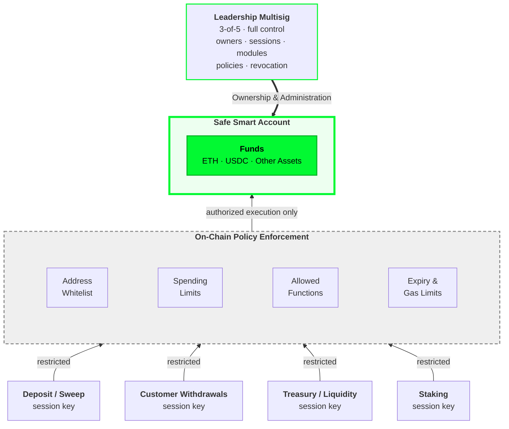

# Safe Session-Key Security Template

**What if compromising an exchange's operational keys didn't mean compromising its funds?**

This open-source reference implementation demonstrates how Safe smart accounts and restricted
session keys can separate ownership from execution.

Leadership retains full control of the wallet through a multisig. Operational infrastructure
receives narrowly scoped permissions, enforced on-chain.

Even if an operational key is compromised and delegates execution to malicious code through
EIP-7702, it cannot gain unrestricted authority over the Safe.

> This is a proof of concept. It demonstrates the architecture and provides reusable policy
> examples; it is not production-ready custody infrastructure and has not been audited.

## The security model



**The Safe holds the funds. Leadership controls the Safe. Exchange infrastructure operates through restricted session keys, with every authorized session execution subject to on-chain policy enforcement.**

<sub>The four session-key roles are illustrative; the demo runs a single payout session. Monitoring deposits needs no Safe permissions, only sweeping them does. Withdrawals to arbitrary customer addresses need an additional authorization layer that this template does not include.</sub>

- **Leadership owns the funds.** Only the multisig can change owners, modules, sessions or
  policies, and only it can move funds without limits.
- **Infrastructure executes within predefined permissions.** A session key can only make the
  transfers its policies allow: to whom, how much, which operations, until when.
- **A compromised key can't bypass them.** Nor can code it installs with EIP-7702. The
  permissions are checked by the Safe's own execution path, not by an API in front of it. Stealing
  the key gives the attacker the session's remaining budget to whitelisted payees, and nothing
  else, until leadership revokes it.

## See it

[`./script/demo.sh`](script/demo.sh) runs the whole story with real transactions on a local chain.
The full recorded run is in [docs/DEMO.md](docs/DEMO.md).

```text
Act 2 - Compromise: the attacker steals the session key and installs EIP-7702 code
  Session key delegates its EOA to MaliciousDelegation PASS     PASS   [type-4 tx; code 0x -> 0xef0100…]

Act 3 - Attack: the malicious code tries to drain the Safe
  Drain via 9 direct routes (module, owner sigs, ...)  BLOCK    BLOCK  [0/9 succeeded]
  Drain 10 ETH to attacker through the session         BLOCK    BLOCK  [PolicyViolation by addressPolicy]
  Add attacker as a Safe owner                         BLOCK    BLOCK  [PolicyViolation by functionPolicy]
  Install an unrestricted module                       BLOCK    BLOCK  [NoPoliciesSet]
  Siphon Safe ETH as inflated gas fees                 BLOCK    BLOCK  [PolicyViolation by gasPolicy]
  Pay 1 ETH to alice (still within the permissions)    PASS     PASS

Act 4 - Leadership is still in control
  3-of-5 multisig revokes the compromised session      PASS     PASS
  Compromised key tries again after revocation         BLOCK    BLOCK  [InvalidPermissionId]

  attacker  0 ETH   0 USDC
```

## Reproduce

Requirements: [Foundry](https://getfoundry.sh) ≥ 1.0, pnpm, jq.

```bash
pnpm install        # pinned Solidity dependencies
./script/demo.sh    # the attack demonstration (local anvil chain, ~1 minute)
pnpm test           # the test suite behind it
```

## What's inside

Built on audited, maintained components rather than a new session framework:

| Layer | Component |
|---|---|
| Custody | [Safe](https://github.com/safe-global/safe-smart-account) v1.4.1, 3-of-5 in the demo |
| Smart-account modules | Rhinestone [Safe7579](https://github.com/rhinestonewtf/safe7579) adapter v1.0.0 |
| Session keys | [SmartSessions](https://github.com/erc7579/smartsessions) (Rhinestone and Biconomy), with Rhinestone's OwnableValidator |
| Execution | ERC-4337 EntryPoint v0.7 |

The reusable policies in [`src/policies/`](src/policies) are this repository's own:

- **[FunctionWhitelistPolicy](src/policies/FunctionWhitelistPolicy.sol):** which operations are
  allowed, e.g. ETH transfers and `USDC.transfer`. It never allows calls to the Safe itself or
  token approvals.
- **[AddressWhitelistPolicy](src/policies/AddressWhitelistPolicy.sol):** who may receive funds. It
  checks the real beneficiary, including the recipient inside an ERC-20 transfer, not just the
  token contract.
- **[SpendingLimitPolicy](src/policies/SpendingLimitPolicy.sol):** how much, per transfer and per
  period (e.g. 1 ETH per transfer, 5 ETH per day).
- **[GasFeeCapPolicy](src/policies/GasFeeCapPolicy.sol):** together with SmartSessions'
  `SimpleGasPolicy`, caps how much ETH the Safe can spend on gas. A stolen key could otherwise
  drain ETH as inflated fees; the tests show 42 ETH in a single operation without it.

[`MaliciousDelegation.sol`](src/examples/MaliciousDelegation.sol) is the deliberately malicious
EIP-7702 implementation used in the demo.

## Add your own policy

A policy is a small contract that SmartSessions calls for every operation of a session. It can
only allow or deny, never grant. Inherit
[`SessionPolicyBase`](src/policies/SessionPolicyBase.sol) and implement two functions:
`_configure` (store the session's settings) and `_check` (allow or deny one execution).
Leadership then attaches it to a session with one multisig transaction.

[docs/ADDING_POLICIES.md](docs/ADDING_POLICIES.md) walks through a complete, tested example (a
business-hours policy).

## What this does not do

- **It does not make a stolen key harmless.** The key keeps its own permissions, so size
  whitelists and limits as the loss you are willing to accept, and revoke quickly.
- **It trusts leadership.** A compromised signing quorum controls everything.
- **It uses static whitelists.** Exchanges pay previously unknown customer addresses. The natural
  next step is a separate *independent withdrawal authorization* module: each withdrawal
  authorized for its exact recipient, token, amount and nonce, with aggregate limits on-chain.
- **SpendingLimitPolicy needs your own bundler.** Its daily window reads the block timestamp,
  which public ERC-4337 mempools don't allow. This affects liveness, not safety.
- **It is not production custody.** No key management, monitoring or recovery tooling, and no
  audit.

## Further reading

| Document | For |
|---|---|
| [docs/DEMO.md](docs/DEMO.md) | The recorded demonstration |
| [docs/ARCHITECTURE.md](docs/ARCHITECTURE.md) | Components, execution flow, session configuration |
| [docs/THREAT_MODEL.md](docs/THREAT_MODEL.md) | Trust assumptions and the adversarial review, path by path |
| [docs/ADDING_POLICIES.md](docs/ADDING_POLICIES.md) | Writing, testing and attaching a policy |
| [docs/SECURITY_REVIEW.md](docs/SECURITY_REVIEW.md) | Internal review: findings, test evidence, open items |

## License

Code in this repository is MIT, and the contracts in `src/` compile only MIT sources. The
dependencies are licensed differently, including AGPL-3.0 parts of SmartSessions and
OwnableValidator, and some upstream files have no clear licence. **Resolve this before public
distribution.** Details are in [docs/SECURITY_REVIEW.md §7](docs/SECURITY_REVIEW.md).
# binance-hack-solution
