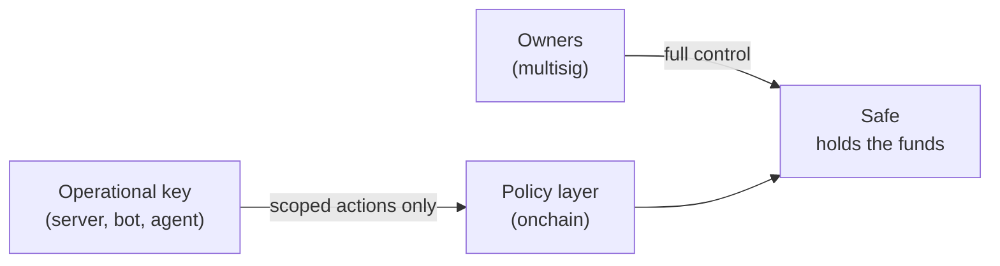

# Restricted Operator Keys for Safe

[](https://github.com/theexoticman/binance-hack-solution/actions/workflows/ci.yml)
[](LICENSE)

**What if compromising an operational key didn't mean compromising the funds?**

Exchanges, custodians and protocol operators run servers and bots that sign transactions all
day. When those keys also hold the funds, stealing one key is enough to drain everything. This
repository shows how to **separate funds from actions** with a [Safe](https://safe.global)
smart account, and implements and compares two ways of doing it.

**Want a Safe set up this way?** [Deploy your own](#deploy-your-own-policy-restrained-operator-keys)
from one config file, in one transaction.

> Proof of concept. It demonstrates the architecture and provides reusable, tested components; it
> is not production custody infrastructure and has not been audited.

## What you will find in this repository

| Part | What it is | Where |
|---|---|---|
| **Policy-restrained operator keys** | A ready-to-use deployer: one config file and one transaction give you a new Safe with its owners, operational keys (Zodiac Roles) and policies (Safe Policy Engine) | [Deploy your own](#deploy-your-own-policy-restrained-operator-keys), [safe-factory/](safe-factory/) |
| **Two approaches, compared** | Session keys (Smart Sessions) and Zodiac Roles, each behind Safe Policy Engine, run through one shared security suite of 31 attack scenarios, with gas and attack-surface measurements and a recommendation | [Two approaches](#two-approaches), [docs/OPERATOR_KEY_COMPARISON.md](docs/OPERATOR_KEY_COMPARISON.md) |
| **Session-key template and attack demo** | The original Smart Sessions setup with four MIT session policies, and a recorded demo where a stolen key delegated to malicious EIP-7702 code fails to drain the Safe | [src/policies/](src/policies), [docs/DEMO.md](docs/DEMO.md) |
| **A real workload: SafeNet sentinel** | The recommended approach applied to a SafeNet sentinel, tested against the production oracle on a Gnosis mainnet fork | [docs/SENTINEL.md](docs/SENTINEL.md) |
| **Design documents** | Architecture, threat model, security review, how to write a policy | [Documentation](#documentation) |

## The idea



- **The Safe holds the funds.** Operational keys never do.
- **Owners control the Safe.** Only the multisig changes owners, modules, keys or rules, and only
  it can move funds without limits.
- **Operational keys get a mandate.** A key can make only the calls it was granted: which
  contract, which function, which arguments, how much.
- **The mandate is enforced onchain.** It is checked in the Safe's own execution path, not by an
  API in front of it. A stolen key gives an attacker that mandate and nothing more, until the
  owners revoke it.

## Deploy your own: policy-restrained operator keys

The setup this repository recommends (see [Two approaches](#two-approaches)), packaged so anyone
can deploy it: write a config file with the owners, the
operational keys and what each key may do, and one transaction creates the Safe with Zodiac Roles
(the keys) and Safe Policy Engine (the policies) fully configured. No owner signs anything, and the
Safe never exists without its restrictions.

The deployer covers this Zodiac Roles + Safe Policy Engine setup only. The session-key approach
(Smart Sessions) has no deployer; its scripts deploy it for the local demo and the benchmark only.

After the [Quick start](#quick-start) install, start from an example and replace its placeholders:

```bash
cp safe-factory/examples/payouts.json safe-factory/my-safe.json                    # then edit it
pnpm safe:deploy safe-factory/my-safe.json --rpc-url $RPC_URL                      # dry run
pnpm safe:deploy safe-factory/my-safe.json --rpc-url $RPC_URL --broadcast --account deployer
```

`deployer` is any funded account in Foundry's keystore (`cast wallet import deployer --interactive`);
it gets no rights over the Safe. The script is
[script/factory/DeployRestrictedSafe.s.sol](script/factory/DeployRestrictedSafe.s.sol), and
`pnpm safe:e2e` runs the whole flow on a local anvil chain.

Everything is in **[safe-factory/](safe-factory/)**: how it works, the config format, examples
(USDC payouts, the SafeNet sentinel), the shared contract addresses and the limits.

> **This deploys a new Safe, so the funds have to move.** The keys and policies protect only what the
> new Safe holds. If your funds sit in a hot wallet, an EOA or an existing Safe today, migrate them to
> the new Safe once it is deployed and checked, starting with a small test transfer. The operational
> keys must stop holding funds themselves.

## Two approaches

### 1. Session keys (Smart Sessions)

The key is an ERC-7579 session on the Safe ([SmartSessions](https://github.com/erc7579/smartsessions)
through the [Safe7579](https://github.com/rhinestonewtf/safe7579) adapter). It signs ERC-4337
user operations, and each one passes the session's policies before it executes.


This is the repository's original template, on Safe v1.4.1. It ships four MIT session policies in
[`src/policies/`](src/policies): which functions
([FunctionWhitelist](src/policies/FunctionWhitelistPolicy.sol)), which recipients
([AddressWhitelist](src/policies/AddressWhitelistPolicy.sol)), how much
([SpendingLimit](src/policies/SpendingLimitPolicy.sol)) and how much gas the Safe pays
([GasFeeCap](src/policies/GasFeeCapPolicy.sol)). The demo steals a session key, delegates it to
malicious EIP-7702 code and tries every route to drain the Safe; the attacker gets nothing.

- Design: [docs/ARCHITECTURE.md](docs/ARCHITECTURE.md) · threat model: [docs/THREAT_MODEL.md](docs/THREAT_MODEL.md) · recorded demo: [docs/DEMO.md](docs/DEMO.md)
- Writing your own policy: [docs/ADDING_POLICIES.md](docs/ADDING_POLICIES.md)

### 2. Zodiac Roles

The key is a member of a role in a [Zodiac Roles](https://github.com/gnosisguild/zodiac-modifier-roles)
v2.1.1 module attached to the Safe. It sends an ordinary transaction to the module, which checks the
call against the role's conditions (target, function, argument values, allowances) and forwards it
to the Safe. There is no ERC-4337 stack and no bundler.

### Both behind Safe Policy Engine

For the comparison, both approaches run on Safe v1.5.0 behind
[Safe Policy Engine](https://github.com/safe-research/policy-engine): a default-deny guard that
checks every module and owner transaction. It is a second, independent floor: a misconfigured or
compromised Roles or Smart Sessions module still can't do anything the engine doesn't allow.

Both were given the same mandate (USDC to two payees, ≤ 1000 per transfer, ≤ 3000 a day) and run
through one shared security suite of 31 scenarios, each attempted through the key, as the module
itself and with the module deliberately misconfigured.

| | Zodiac Roles | Smart Sessions |
|---|---|---|
| Implementation | [ZodiacRolesHarness](test/operator-keys/utils/ZodiacRolesHarness.sol), [tests](test/operator-keys/ZodiacRoles.t.sol) | [SmartSessionsHarness](test/operator-keys/utils/SmartSessionsHarness.sol), [tests](test/operator-keys/SmartSessions.t.sol) |
| Shared security suite ([OperatorKeySuite](test/operator-keys/OperatorKeySuite.sol)) | all pass | all pass |
| Gas per authorized action | 198,428 | 306,197 |
| Key rotation (one owner tx) | 178,038 | 1,138,040 |
| Contracts that can make the Safe act | 2 | 12 (6 fixed + 1 per session policy; 6 in the tested setup) |
| Offchain infrastructure | none | a private ERC-4337 bundler |
| Native key expiry | no | yes |

**Recommendation: Zodiac Roles.** Both blocked every attack. Roles does it with a smaller attack
surface, no bundler and lower cost. Session keys' one advantage is native expiry. The full report,
with every scenario, measurement, pro and con:
**[docs/OPERATOR_KEY_COMPARISON.md](docs/OPERATOR_KEY_COMPARISON.md)**.

## Applied: a SafeNet sentinel

The recommended approach on a real workload. A Safe holds a [SafeNet](https://github.com/safe-research/safenet)
sentinel's USDC.e bonds and is the registered sentinel. The sentinel server holds one Roles key,
`SENTINEL`, that can only approve the oracle for at most one bond (800 USDC.e) and call `commit`,
`reveal`, `finalize`, `claim` and `timeoutArbitration`. Keys rotate with two owner transactions,
new fee tokens can be added, and an existing EOA sentinel can migrate to the Safe without losing
in-flight requests.

It is tested locally and on a Gnosis mainnet fork against the production oracle, through a full
propose, commit, reveal, attest and claim cycle: **[docs/SENTINEL.md](docs/SENTINEL.md)**.

## Quick start

Requirements: [Foundry](https://getfoundry.sh) ≥ 1.0, [pnpm](https://pnpm.io), `jq`.

```bash
git clone https://github.com/theexoticman/binance-hack-solution.git
cd binance-hack-solution
git submodule update --init lib/safenet   # SafeNet sources, for the sentinel tests
pnpm install                              # pinned dependencies; no install scripts run
pnpm test                                 # everything
```

| Command | Runs |
|---|---|
| `./script/demo.sh` | Session-key attack demo on a local anvil chain (~1 minute) |
| `forge test --mc 'ZodiacRoles\|SmartSessions'` | Both approaches against the shared suite |
| `pnpm gas:operator-keys` | Gas benchmark of both, written to `snapshots/` |
| `pnpm bench:operator-keys` | Deploys and exercises both on anvil, gas from receipts |
| `forge test --mc SentinelSafeTest` | Sentinel suite, local |
| `GNOSIS_RPC_URL=<rpc> pnpm test:fork:sentinel` | Sentinel suite on a Gnosis mainnet fork |
| `pnpm safe:e2e` | Policy-restrained operator keys end to end on anvil: config file to deployed, checked Safe |
| `./script/check-licenses.sh` | Checks that `src/` compiles only MIT sources |

`pnpm test` runs `forge test`, then the ERC-7562 tests again with `-vvv`; they need Foundry's
opcode tracer, so the first pass skips them. Fork tests are skipped without `GNOSIS_RPC_URL`.

## Repository layout

```text
src/
  policies/           session-key policies (approach 1) and their shared base
  policies/engine/    Policy Engine policies for the comparison: OwnerOnly, Safe7579Batch
  sentinel/           Policy Engine policies for the sentinel: ERC20ApproveCap, OwnerOnly
  factory/            RestrictedSafeSetup: sets up a new Safe from inside its creation transaction
  interfaces/         MIT copies of the SmartSessions and Policy Engine interfaces
  libraries/          TransferLib: strict decoding of ETH and ERC-20 transfers
  examples/           MaliciousDelegation, the attacker's EIP-7702 code in the demo
script/
  demo.sh, DeployDemo.s.sol, lib/SessionSetup.sol                  session-key template
  DeployOperatorKeys.s.sol, lib/OperatorKeySetup.sol,
    bench-operator-keys.sh                                          comparison
  sentinel/SentinelSetup.sol                                        sentinel owner transactions
  factory/                                                          policy-restrained operator keys: deploy script
test/
  *.t.sol, utils/     session-key template, one file per attack category
  operator-keys/      comparison: shared suite, one harness per approach, gas
  sentinel/           sentinel: local and Gnosis fork suites
  factory/            policy-restrained operator keys: tests and fixture
safe-factory/         policy-restrained operator keys: README, example configs, JSON Schema
docs/                 architecture, threat model, security review, demo, comparison, sentinel
snapshots/            gas snapshots of the comparison
lib/safenet/          SafeNet, pinned git submodule (sentinel tests only)
```

## Limitations

- **A stolen key keeps its mandate** until the owners revoke it. Size limits as the loss you
  accept, and revoke fast.
- **The owners are trusted.** A compromised signing quorum controls everything.
- **Mandates use static allow-lists.** Paying arbitrary customer addresses needs a separate
  per-withdrawal authorization layer, which is not included.
- **Session keys have extra operational needs.** `SpendingLimitPolicy` reads the block timestamp,
  and under the Policy Engine validation touches guard storage; both need your own bundler.
- **Zodiac Roles v2.1.1 has no key expiry.** The comparison report lists the options.
- **Not audited.** This includes the new policies in `src/policies/engine/` and `src/sentinel/`.

## Documentation

| Document | Covers |
|---|---|
| [docs/ARCHITECTURE.md](docs/ARCHITECTURE.md) | Session-key template: components, execution flow, configuration |
| [docs/THREAT_MODEL.md](docs/THREAT_MODEL.md) | Session-key template: trust assumptions, adversarial review path by path |
| [docs/SECURITY_REVIEW.md](docs/SECURITY_REVIEW.md) | Session-key template: findings, test evidence, open items, licensing |
| [docs/ADDING_POLICIES.md](docs/ADDING_POLICIES.md) | Writing, testing and attaching a session policy |
| [docs/DEMO.md](docs/DEMO.md) | The recorded attack demo |
| [docs/OPERATOR_KEY_COMPARISON.md](docs/OPERATOR_KEY_COMPARISON.md) | Zodiac Roles vs. Smart Sessions behind Safe Policy Engine |
| [docs/SENTINEL.md](docs/SENTINEL.md) | Running a SafeNet sentinel from a Safe with a Roles key |
| [safe-factory/README.md](safe-factory/README.md) | Policy-restrained operator keys: deploying a Safe with its keys and policies from one config file |

## Contributing and security

Issues and pull requests are welcome, especially new attack paths, new policies and doc
corrections; see [CONTRIBUTING.md](CONTRIBUTING.md). If you find a way around the restrictions,
report it privately as described in [SECURITY.md](SECURITY.md), not in a public issue.

## License

This repository's code is [MIT](LICENSE), and the contracts in `src/` compile only MIT sources
(`./script/check-licenses.sh` checks this). Dependencies carry their own licenses: AGPL-3.0 for
parts of SmartSessions and OwnableValidator, LGPL-3.0 for Zodiac Roles and Safe Policy Engine, and
GPL-3.0 for SafeNet (compiled only by the sentinel tests). Check those terms before deploying or
redistributing the stack. The full inventory is in
[docs/SECURITY_REVIEW.md §7](docs/SECURITY_REVIEW.md#7-licensing).
