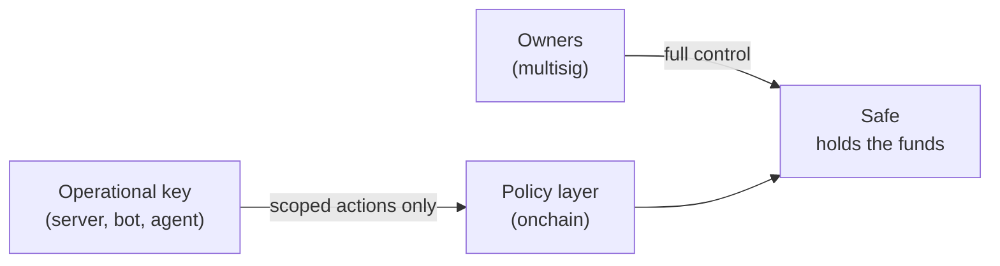

# Restricted Operator Keys for Safe

[](https://github.com/theexoticman/binance-hack-solution/actions/workflows/ci.yml)
[](LICENSE)

**What if compromising an operational key didn't mean compromising the funds?**

Exchanges, custodians and protocol operators run servers and bots that sign transactions all day.
When those keys also hold the funds, one stolen key drains everything. This repository
**separates funds from actions** with a [Safe](https://safe.global): it compares two ways of doing
it, applies the winner to a real workload, and packages it as a one-transaction
[deployer](#deploy-your-own-policy-restrained-operator-keys).

> Proof of concept, not audited. Not production custody infrastructure.

## The idea



- **The Safe holds the funds**; operational keys never do.
- **Owners control the Safe.** Only the multisig changes keys or rules, or moves funds without limits.
- **Each key gets a mandate**: which contract, which function, which arguments, how much.
- **The mandate is enforced onchain**, in the Safe's own execution path. A stolen key gives an
  attacker that mandate and nothing more, until the owners revoke it.

## Deploy your own: policy-restrained operator keys

Write a config file with the owners, the operational keys and what each key may do. One transaction
creates the Safe with Zodiac Roles (the keys) and Safe Policy Engine (the policies) already
configured; the Safe never exists without its restrictions. This covers the Zodiac Roles setup
only; the session-key approach has no deployer.

After the [Quick start](#quick-start) install:

```bash
cp safe-factory/examples/payouts.json safe-factory/my-safe.json   # then replace the placeholders
cast wallet import deployer --interactive                         # any funded account; it gets no rights
pnpm safe:deploy safe-factory/my-safe.json --rpc-url $RPC_URL                                 # dry run
pnpm safe:deploy safe-factory/my-safe.json --rpc-url $RPC_URL --broadcast --account deployer
```

The script is [DeployRestrictedSafe.s.sol](script/factory/DeployRestrictedSafe.s.sol), and
`pnpm safe:e2e` runs the whole flow on anvil. Config format, examples, contract addresses and
limits: **[safe-factory/](safe-factory/)**.

> **It deploys a new Safe, so the funds have to move.** Once the Safe is deployed and checked,
> migrate the funds from wherever they are today, starting with a small test transfer.

## Two approaches, compared

1. **Session keys** ([SmartSessions](https://github.com/erc7579/smartsessions) via Rhinestone's
   [Safe7579](https://github.com/rhinestonewtf/safe7579)): the key signs ERC-4337 user operations,
   each checked by the session's policies. This is the original template, with four MIT session
   policies in [src/policies/](src/policies) and a [recorded demo](docs/DEMO.md) where a stolen key
   delegated to malicious EIP-7702 code fails to drain the Safe.
2. **[Zodiac Roles](https://github.com/gnosisguild/zodiac-modifier-roles) v2.1.1**: the key sends an
   ordinary transaction to a Roles module, which checks target, function, arguments and allowances,
   then forwards it to the Safe. No ERC-4337 stack, no bundler.

Both ran on Safe v1.5.0 behind [Safe Policy Engine](https://github.com/safe-research/policy-engine),
a default-deny guard on every owner and module transaction, so even a misconfigured or compromised
module can't exceed it. Both got the same mandate (USDC to two payees, ≤ 1000 per transfer, ≤ 3000 a
day) and the same 31 attack scenarios ([OperatorKeySuite](test/operator-keys/OperatorKeySuite.sol)).

| | Zodiac Roles | Smart Sessions |
|---|---|---|
| Shared security suite | all pass | all pass |
| Gas per authorized action | 198,428 | 306,197 |
| Key rotation (one owner tx) | 178,038 | 1,138,040 |
| Contracts that can make the Safe act | 2 | 12 (6 fixed + 1 per session policy; 6 tested) |
| Offchain infrastructure | none | a private ERC-4337 bundler |
| Native key expiry | no | yes |

**Recommendation: Zodiac Roles**: same protection, smaller attack surface, no bundler, lower cost.
Session keys' one real advantage is native expiry. Full report:
**[docs/OPERATOR_KEY_COMPARISON.md](docs/OPERATOR_KEY_COMPARISON.md)**.

## Applied: a SafeNet sentinel

A Safe holds a [SafeNet](https://github.com/safe-research/safenet) sentinel's USDC.e bonds and is the
registered sentinel; the server's Roles key can only run the oracle protocol and approve at most one
bond. Tested on a Gnosis mainnet fork against the production oracle:
**[docs/SENTINEL.md](docs/SENTINEL.md)**.

## Quick start

Requirements: [Foundry](https://getfoundry.sh) ≥ 1.0, [pnpm](https://pnpm.io), `jq`.

```bash
git clone https://github.com/theexoticman/binance-hack-solution.git
cd binance-hack-solution
git submodule update --init lib/safenet   # SafeNet sources, for the sentinel tests
pnpm install                              # pinned dependencies; no install scripts run
pnpm test                                 # everything (fork tests skipped without GNOSIS_RPC_URL)
```

| Command | Runs |
|---|---|
| `pnpm safe:e2e` | Deployer end to end on anvil: config file to deployed, checked Safe |
| `./script/demo.sh` | Session-key attack demo on anvil (~1 minute) |
| `forge test --mc 'ZodiacRoles\|SmartSessions'` | Both approaches against the shared suite |
| `pnpm gas:operator-keys` / `pnpm bench:operator-keys` | Gas of both: in tests (to `snapshots/`) / from anvil receipts |
| `GNOSIS_RPC_URL=<rpc> pnpm test:fork:sentinel` | Sentinel suite on a Gnosis mainnet fork |
| `./script/check-licenses.sh` | Checks that `src/` compiles only MIT sources |

## Repository layout

```text
src/factory/, script/factory/, test/factory/, safe-factory/   deployer
src/policies/, script/demo.sh, script/DeployDemo.s.sol         session-key template
test/operator-keys/, script/DeployOperatorKeys.s.sol           comparison
src/sentinel/, script/sentinel/, test/sentinel/                SafeNet sentinel
docs/                                                          design documents
```

## Limitations

- **A stolen key keeps its mandate** until the owners revoke it. Size limits as the loss you accept.
- **The owners are trusted.** A compromised signing quorum controls everything.
- **Mandates use static allow-lists.** Paying arbitrary customer addresses needs a separate
  per-withdrawal authorization layer, not included.
- **Zodiac Roles v2.1.1 has no key expiry**; session keys need your own bundler. See the comparison.
- **Not audited**, including the new policies in `src/policies/engine/`, `src/sentinel/` and `src/factory/`.

## Documentation

| Document | Covers |
|---|---|
| [safe-factory/README.md](safe-factory/README.md) | The deployer: how it works, config format, addresses, limits |
| [docs/OPERATOR_KEY_COMPARISON.md](docs/OPERATOR_KEY_COMPARISON.md) | Zodiac Roles vs. Smart Sessions behind Safe Policy Engine |
| [docs/SENTINEL.md](docs/SENTINEL.md) | Running a SafeNet sentinel from a Safe with a Roles key |
| [docs/ARCHITECTURE.md](docs/ARCHITECTURE.md), [THREAT_MODEL.md](docs/THREAT_MODEL.md), [SECURITY_REVIEW.md](docs/SECURITY_REVIEW.md) | Session-key template: design, threat model, findings |
| [docs/ADDING_POLICIES.md](docs/ADDING_POLICIES.md), [DEMO.md](docs/DEMO.md) | Writing a session policy; the recorded attack demo |

## Contributing, security and license

Issues and pull requests are welcome; see [CONTRIBUTING.md](CONTRIBUTING.md). Report a way around
the restrictions privately, as described in [SECURITY.md](SECURITY.md).

The code is [MIT](LICENSE), and `src/` compiles only MIT sources. Dependencies carry their own
licenses (AGPL-3.0, LGPL-3.0, GPL-3.0); check them before deploying or redistributing. Inventory:
[docs/SECURITY_REVIEW.md §7](docs/SECURITY_REVIEW.md#7-licensing).
