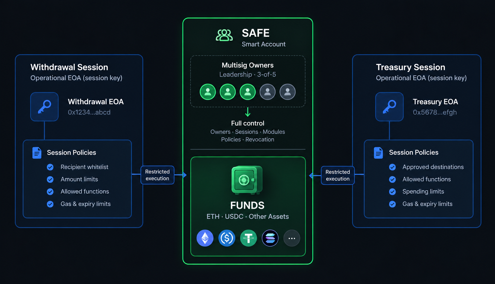

# Safe Session-Key Security Template

[](https://github.com/theexoticman/binance-hack-solution/actions/workflows/ci.yml)
[](LICENSE)

**What if compromising an exchange's operational keys didn't mean compromising its funds?**

This open-source reference implementation demonstrates how Safe smart accounts and restricted
session keys can separate ownership from execution.

Leadership retains full control of the wallet through a multisig. Operational infrastructure
receives narrowly scoped permissions, enforced on-chain.

Even if an operational key is compromised and delegates execution to malicious code through
EIP-7702, it cannot gain unrestricted authority over the Safe.

> This is a proof of concept. It demonstrates the architecture and provides reusable policy
> examples; it is not production-ready custody infrastructure and has not been audited.

## What's in this repository

| Part | What it is | Start here |
|---|---|---|
| **Session-key template** | The original reference: a Safe with Smart Sessions keys, four session policies and an attack demo | This README, [docs/ARCHITECTURE.md](docs/ARCHITECTURE.md) |
| **Two approaches, compared** | The same restricted operator key built twice, with **Zodiac Roles** and with **Smart Sessions**, both behind **Safe Policy Engine**, and run through one shared security suite and gas benchmark | [docs/OPERATOR_KEY_COMPARISON.md](docs/OPERATOR_KEY_COMPARISON.md) |
| **SafeNet sentinel** | The recommended approach (Roles) applied to a real case: a Safe that runs as a SafeNet sentinel, tested on a Gnosis mainnet fork | [docs/SENTINEL.md](docs/SENTINEL.md) |

The template's own sections follow. The [comparison](#two-approaches-compared) and the
[sentinel](#safenet-sentinel) are summarized further down.

## The security model



**The Safe holds the funds. Leadership controls the Safe. Exchange infrastructure operates through restricted session keys, with every authorized session execution subject to on-chain policy enforcement.**

<sub>The withdrawal and treasury sessions are illustrative; the demo runs a single payout session. Withdrawals to arbitrary customer addresses need an additional authorization layer that this template does not include.</sub>

- **Leadership owns the funds.** Only the multisig can change owners, modules, sessions or
  policies, and only it can move funds without limits.
- **Infrastructure executes within predefined permissions.** A session key can only make the
  transfers its policies allow: to whom, how much, which operations, until when.
- **A compromised key can't bypass them.** Nor can code it installs with EIP-7702. The
  permissions are checked by the Safe's own execution path, not by an API in front of it. Stealing
  the key gives the attacker the session's remaining budget to whitelisted payees, and nothing
  else, until leadership revokes it.

## See it

[`./script/demo.sh`](script/demo.sh) runs the whole story with real transactions on a local chain.
The full recorded run is in [docs/DEMO.md](docs/DEMO.md).

```text
Act 2 - Compromise: the attacker steals the session key and installs EIP-7702 code
  Session key delegates its EOA to MaliciousDelegation PASS     PASS   [type-4 tx; code 0x -> 0xef0100…]

Act 3 - Attack: the malicious code tries to drain the Safe
  Drain via 9 direct routes (module, owner sigs, ...)  BLOCK    BLOCK  [0/9 succeeded]
  Drain 10 ETH to attacker through the session         BLOCK    BLOCK  [PolicyViolation by addressPolicy]
  Add attacker as a Safe owner                         BLOCK    BLOCK  [PolicyViolation by functionPolicy]
  Install an unrestricted module                       BLOCK    BLOCK  [NoPoliciesSet]
  Siphon Safe ETH as inflated gas fees                 BLOCK    BLOCK  [PolicyViolation by gasPolicy]
  Pay 1 ETH to alice (still within the permissions)    PASS     PASS

Act 4 - Leadership is still in control
  3-of-5 multisig revokes the compromised session      PASS     PASS
  Compromised key tries again after revocation         BLOCK    BLOCK  [InvalidPermissionId]

  attacker  0 ETH   0 USDC
```

## Reproduce

Requirements: [Foundry](https://getfoundry.sh) ≥ 1.0, [pnpm](https://pnpm.io), jq.

```bash
git clone https://github.com/theexoticman/binance-hack-solution.git
cd binance-hack-solution
git submodule update --init lib/safenet   # SafeNet sources, used by the sentinel tests
pnpm install        # pinned Solidity dependencies (no install scripts are run)
./script/demo.sh    # the attack demonstration (local anvil chain, ~1 minute)
pnpm test           # the test suite behind it
```

`pnpm test` runs `forge test` and then the ERC-7562 suite a second time with `-vvv`. Those 7
tests need Foundry's opcode tracer, so the first pass reports them as skipped and the second
pass runs them.

## What's inside

Built on audited, maintained components rather than a new session framework:

| Layer | Component |
|---|---|
| Custody | [Safe](https://github.com/safe-global/safe-smart-account) v1.4.1, 3-of-5 in the demo |
| Smart-account modules | Rhinestone [Safe7579](https://github.com/rhinestonewtf/safe7579) adapter v1.0.0 |
| Session keys | [SmartSessions](https://github.com/erc7579/smartsessions) (Rhinestone and Biconomy), with Rhinestone's OwnableValidator |
| Execution | ERC-4337 EntryPoint v0.7 |

The reusable policies in [`src/policies/`](src/policies) are this repository's own:

- **[FunctionWhitelistPolicy](src/policies/FunctionWhitelistPolicy.sol):** which operations are
  allowed, e.g. ETH transfers and `USDC.transfer`. It never allows calls to the Safe itself or
  token approvals.
- **[AddressWhitelistPolicy](src/policies/AddressWhitelistPolicy.sol):** who may receive funds. It
  checks the real beneficiary, including the recipient inside an ERC-20 transfer, not just the
  token contract.
- **[SpendingLimitPolicy](src/policies/SpendingLimitPolicy.sol):** how much, per transfer and per
  period (e.g. 1 ETH per transfer, 5 ETH per day).
- **[GasFeeCapPolicy](src/policies/GasFeeCapPolicy.sol):** together with SmartSessions'
  `SimpleGasPolicy`, caps how much ETH the Safe can spend on gas. A stolen key could otherwise
  drain ETH as inflated fees; the tests show 42 ETH in a single operation without it.

[`MaliciousDelegation.sol`](src/examples/MaliciousDelegation.sol) is the deliberately malicious
EIP-7702 implementation used in the demo.

```text
src/
  policies/        the four session policies and their shared base
  policies/engine/ Policy Engine policies for the comparison (OwnerOnly, Safe7579Batch)
  sentinel/        Policy Engine policies for the sentinel (ERC20ApproveCap, OwnerOnly)
  libraries/       TransferLib: strict decoding of ETH and ERC-20 transfers
  interfaces/      MIT copies of the SmartSessions and Policy Engine interfaces
  examples/        MaliciousDelegation, the attacker's EIP-7702 code
script/
  demo.sh          the attack demonstration
  DeployDemo.s.sol, lib/SessionSetup.sol                 template deployment and sessions
  DeployOperatorKeys.s.sol, lib/OperatorKeySetup.sol,
    bench-operator-keys.sh                               comparison deployment and benchmark
  sentinel/SentinelSetup.sol                             sentinel owner transactions
test/              template: one file per attack category, shared fixtures in test/utils/
  operator-keys/   comparison: shared suite, per-architecture harnesses and tests, gas
  sentinel/        sentinel: local suite and Gnosis fork suite
snapshots/         gas snapshots from `pnpm gas:operator-keys`
lib/safenet/       SafeNet (git submodule, pinned), compiled only by the sentinel tests
docs/              architecture, threat model, security review, demo, comparison, sentinel
```

## Add your own policy

A policy is a small contract that SmartSessions calls for every operation of a session. It can
only allow or deny, never grant. Inherit
[`SessionPolicyBase`](src/policies/SessionPolicyBase.sol) and implement two functions:
`_configure` (store the session's settings) and `_check` (allow or deny one execution).
Leadership then attaches it to a session with one multisig transaction.

[docs/ADDING_POLICIES.md](docs/ADDING_POLICIES.md) walks through a complete, tested example (a
business-hours policy).

## Two approaches, compared

The template above puts session keys straight on the Safe. For production use we wanted a
second, mandatory layer: [Safe Policy Engine](https://github.com/safe-research/policy-engine), a
default-deny guard on Safe v1.5.0 that checks every module and owner transaction. Two frameworks
can give a key a restricted mandate behind it, so we built both and gave them the same mandate
(USDC transfers to two payees, ≤ 1000 each, ≤ 3000 a day):

| | Zodiac Roles v2.1.1 | Smart Sessions (ERC-7579) |
|---|---|---|
| Implementation | [ZodiacRolesHarness.sol](test/operator-keys/utils/ZodiacRolesHarness.sol), [ZodiacRoles.t.sol](test/operator-keys/ZodiacRoles.t.sol) | [SmartSessionsHarness.sol](test/operator-keys/utils/SmartSessionsHarness.sol), [SmartSessions.t.sol](test/operator-keys/SmartSessions.t.sol) |
| Shared security suite | [OperatorKeySuite.sol](test/operator-keys/OperatorKeySuite.sol): 31 scenarios, all blocked/allowed as expected | same suite, same result |
| Gas per authorized action | 198,428 | 306,197 |
| Key rotation | 178,038 | 1,138,040 |
| Privileged contracts | 2 | 12 |
| Needs a bundler | no | yes, a private one |
| Native key expiry | no | yes |

Owner transactions for both are in [script/lib/OperatorKeySetup.sol](script/lib/OperatorKeySetup.sol);
[script/DeployOperatorKeys.s.sol](script/DeployOperatorKeys.s.sol) deploys both on a local chain.

**Result:** both stacks blocked every attack, and the engine stopped every bypass. We recommend
Zodiac Roles: smaller attack surface, no ERC-4337 infrastructure, and cheaper to run. The full
report, with every scenario, measurement, pro and con, is
[docs/OPERATOR_KEY_COMPARISON.md](docs/OPERATOR_KEY_COMPARISON.md).

```bash
forge test --mc 'ZodiacRoles|SmartSessions'      # the two implementations
pnpm gas:operator-keys                           # gas benchmark -> snapshots/
pnpm bench:operator-keys                         # deploy and exercise both on anvil
```

## SafeNet sentinel

The recommended approach, applied to a real case. A Safe holds the sentinel's USDC.e and is the
registered SafeNet sentinel. The server holds one Roles key, `SENTINEL`, that can only approve the
oracle for ≤ 800 USDC.e and call `commit`, `reveal`, `finalize`, `claim` and `timeoutArbitration`.
Keys rotate in two owner transactions, new fee tokens can be added, and an existing EOA sentinel can
migrate without losing in-flight requests.

The suite runs locally and on a Gnosis mainnet fork against the production oracle, through a full
propose → commit → reveal → attest → claim cycle. See [docs/SENTINEL.md](docs/SENTINEL.md).

```bash
forge test --mc SentinelSafeTest
GNOSIS_RPC_URL=https://rpc.gnosischain.com pnpm test:fork:sentinel
```

## What this does not do

- **It does not make a stolen key harmless.** The key keeps its own permissions, so size
  whitelists and limits as the loss you are willing to accept, and revoke quickly.
- **It trusts leadership.** A compromised signing quorum controls everything.
- **It uses static whitelists.** Exchanges pay previously unknown customer addresses. The natural
  next step is a separate *independent withdrawal authorization* module: each withdrawal
  authorized for its exact recipient, token, amount and nonce, with aggregate limits on-chain.
- **SpendingLimitPolicy needs your own bundler.** Its daily window reads the block timestamp,
  which public ERC-4337 mempools don't allow. This affects liveness, not safety.
- **It is not production custody.** No key management, monitoring or recovery tooling, and no
  audit.

## Further reading

| Document | For |
|---|---|
| [docs/DEMO.md](docs/DEMO.md) | The recorded demonstration |
| [docs/ARCHITECTURE.md](docs/ARCHITECTURE.md) | Components, execution flow, session configuration |
| [docs/THREAT_MODEL.md](docs/THREAT_MODEL.md) | Trust assumptions and the adversarial review, path by path |
| [docs/ADDING_POLICIES.md](docs/ADDING_POLICIES.md) | Writing, testing and attaching a policy |
| [docs/SECURITY_REVIEW.md](docs/SECURITY_REVIEW.md) | Internal review: findings, test evidence, open items |
| [docs/OPERATOR_KEY_COMPARISON.md](docs/OPERATOR_KEY_COMPARISON.md) | Zodiac Roles vs. Smart Sessions behind Safe Policy Engine: shared security suite, gas, pros and cons, recommendation |
| [docs/SENTINEL.md](docs/SENTINEL.md) | Running a SafeNet sentinel from a Safe with a restricted Roles key: setup, rotation, migration, fork tests |

## Contributing

Issues and pull requests are welcome, especially new attack paths, new policies and
corrections to the docs. See [CONTRIBUTING.md](CONTRIBUTING.md) for the workflow. If you find a
way around the policies, please report it privately as described in [SECURITY.md](SECURITY.md)
instead of opening a public issue.

## License

The code in this repository is [MIT](LICENSE), and the contracts in `src/` compile only MIT
sources (`./script/check-licenses.sh` checks this). The dependencies have other licenses,
including AGPL-3.0 for parts of SmartSessions and OwnableValidator, LGPL-3.0 for Zodiac Roles and
Safe Policy Engine, and GPL-3.0 for SafeNet (compiled only by the sentinel tests). A few upstream
files have no license tag at all. If you deploy or redistribute this stack, check those terms
yourself. The full inventory is in [docs/SECURITY_REVIEW.md §7](docs/SECURITY_REVIEW.md#7-licensing).
