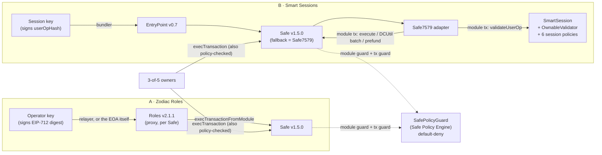

# Restricted operator keys: Zodiac Roles vs. Rhinestone Smart Sessions, behind Safe Policy Engine

**Question.** With Safe Policy Engine as the mandatory enforcement layer, should IntentGuard standardize
on Zodiac Roles or on Rhinestone Smart Sessions for restricted operator keys?

**Answer.** Standardize on **Zodiac Roles v2.1.1**. In this comparison both architectures allowed and
blocked exactly the same operations, and the Policy Engine stopped every bypass attempt in both. Roles
reaches that result with 2 privileged contracts instead of 12, no ERC-4337 infrastructure, about 400
fewer lines of custom onchain code, 35% less gas per execution (6–23% less for batches), and roughly
6–7× cheaper operator registration and rotation. Smart Sessions has one capability Roles v2.1.1 lacks: native expiry. That
matters for AI agents, but it does not justify supporting a second framework (see
[§8](#8-recommendation)).

Evidence labels used below:
**[T]** an executed test (named) · **[M]** a measurement · **[C]** read in the pinned source, not executed ·
**[A]** an assumption.

---

## 1. What was built



Both architectures run on one shared base: Safe v1.5.0 (3-of-5), and `SafePolicyGuard` installed atomically
as both transaction guard and module guard. Both give the operator the same mandate:
`USDC.transfer(to ∈ {alice, bob}, amount ≤ 1000)`, at most 3000 per day, zero value, CALL only.

| | Path |
|---|---|
| Shared suite (31 tests, run against both) | [test/operator-keys/OperatorKeySuite.sol](../test/operator-keys/OperatorKeySuite.sol) |
| A harness + Roles-only tests | [utils/ZodiacRolesHarness.sol](../test/operator-keys/utils/ZodiacRolesHarness.sol), [ZodiacRoles.t.sol](../test/operator-keys/ZodiacRoles.t.sol) |
| B harness + 7579/4337-only tests | [utils/SmartSessionsHarness.sol](../test/operator-keys/utils/SmartSessionsHarness.sol), [SmartSessions.t.sol](../test/operator-keys/SmartSessions.t.sol), [SmartSessionsErc7562.t.sol](../test/operator-keys/SmartSessionsErc7562.t.sol) |
| Gas benchmark | [OperatorKeyGas.t.sol](../test/operator-keys/OperatorKeyGas.t.sol) → [snapshots/](../snapshots) |
| Deployment script / onchain benchmark | [script/DeployOperatorKeys.s.sol](../script/DeployOperatorKeys.s.sol), [script/bench-operator-keys.sh](../script/bench-operator-keys.sh) → [docs/operator-keys/bench-receipts.txt](operator-keys/bench-receipts.txt) |
| Calldata the owners sign (shared by tests and script) | [script/lib/OperatorKeySetup.sol](../script/lib/OperatorKeySetup.sol) |
| New policies (MIT, unaudited) | [OwnerOnlyPolicy](../src/policies/engine/OwnerOnlyPolicy.sol), [Safe7579BatchPolicy](../src/policies/engine/Safe7579BatchPolicy.sol) |

All main tests use real upstream contracts. The only stand-ins are the test tokens and target
contracts.

### Pinned upstream versions

| Component | Pin | Notes |
|---|---|---|
| Safe | `@safe-global/safe-smart-account` **1.5.0** | 1.5.0 is required: the module guard (`setModuleGuard`) does not exist in 1.4.1 [C]. The existing template stays on 1.4.1, unchanged. |
| Safe Policy Engine | `safe-research/policy-engine` @ `8ee68a8` | Built with its upstream settings (via-IR, 10M runs). |
| Zodiac Roles | `gnosisguild/zodiac-modifier-roles` @ `218a516` (**v2.1.1**, LGPL-3.0) | v3 on `main` is **BUSL-1.1 until 2030-03-01** [C]. The upstream `SignatureChecker` fix is reproduced as a pnpm patch. |
| Zodiac core | `@gnosis.pm/zodiac` 3.4.1 (+ patch) | |
| Safe7579 / SmartSessions / OwnableValidator / EntryPoint | same pins as the existing template | Safe7579 v1.0.0, smartsessions @ `f5aaf86`, EntryPoint v0.7 |

The whole comparison (both architectures, plus Safe 1.5.0 and fixtures) is compiled with solc 0.8.30
at **100 optimizer runs**, so the shared components have identical bytecode and gas in A and B. 100
runs is Roles' upstream setting, and it is also forced: at 200 runs Roles is 24,814 bytes, over the
EIP-170 limit. At 100 runs it is 24,346 bytes, leaving 230 bytes of headroom [M]. Forge tests do not
enforce EIP-170; the broadcast did.

### Policy Engine configuration (identical floor, default-deny)

| Access key | Policy | A | B |
|---|---|:-:|:-:|
| `USDC.transfer`, CALL | `ERC20TransferPolicy` {alice, bob} | ✓ | ✓ |
| `MultiSendCallOnly.multiSend`, DELEGATECALL | `MultiSendPolicy` (re-checks each sub-tx) | ✓ | ✓ |
| `Safe.swapOwner` | `IncreasedThresholdPolicy` (4 of 5) | ✓ | ✓ |
| `Safe.disableModule` | `OwnerOnlyPolicy` (kill switch) | ✓ | ✓ |
| `Roles.assignRoles` | `OwnerOnlyPolicy` | ✓ | |
| `SmartSession.enableSessions` / `removeSession` | `OwnerOnlyPolicy` | | ✓ ✓ |
| `SmartSession.validateUserOp` | `AllowedModulePolicy(Safe7579)` | | ✓ |
| EntryPoint, plain ETH (prefund) | `NativeTransferPolicy` | | ✓ |
| `Safe7579DCUtil.execute(Execution[])`, DELEGATECALL | `Safe7579BatchPolicy` | | ✓ |
| **Entries** | | **5** | **9** |

Three of B's entries exist only so that the framework can function at all.

---

## 2. Shared security suite: results

Every prohibited scenario is checked three ways. Each check asserts onchain **effects**, not only
revert status: owners, threshold, modules, both guard slots, fallback handler, singleton, every
balance, allowances, Policy Engine entries, and the operator framework's own state.

1. **Real path.** The correctly configured operator key tries the operation.
2. **Module compromise.** The operator *module* itself (Roles or Safe7579) calls
   `Safe.execTransactionFromModule` with it. The Policy Engine must deny it.
3. **Misconfiguration.** The operator layer is opened up for the target, then the real path is tried
   again. The Policy Engine must deny it. If the operator layer cannot express the operation at all,
   that is recorded instead.

| Scenario | Expected | A Roles | B Sessions | Test |
|---|---|:-:|:-:|---|
| Authorized contract and selector | Allow | ✅ | ✅ | `S01_allow_authorizedContractAndSelector` |
| Authorized batch / daily budget, then refill | Allow | ✅ | ✅ | `S01_allow_authorizedBatch`, `S01_allow_dailyBudgetThenRefill` |
| Unauthorized destination | Block | ✅ | ✅ | `S02` |
| Unauthorized function selector (`burn`) | Block | ✅ | ✅ | `S03` |
| Unauthorized calldata (recipient; amount > cap; value ≠ 0) | Block | ✅ | ✅ | `S04_*` |
| Direct transfer of protected assets (ETH, BOND) | Block | ✅ | ✅ | `S05` |
| Unauthorized token approval | Block | ✅ | ✅ | `S06` |
| Safe ownership modification | Block | ✅ | ✅ | `S07` |
| Module installation/removal | Block | ✅ | ✅ | `S08`, `B_sessionCannotInstallExecutorOrHook` |
| Guard replacement/removal (both guards) | Block | ✅ | ✅ | `S09` |
| Policy configuration modification | Block | ✅ | ✅ | `S10_*` |
| Arbitrary delegatecall | Block | ✅ | ✅ | `S11` |
| Unauthorized MultiSend (atomic) / delegatecall sub-tx | Block | ✅ | ✅ | `S12_*` |
| Compromised/revoked operator; payload pre-signed before revocation | Block | ✅ | ✅ | `S13_*`, `A_payloadSignedBeforeRevocation_*`, `B_userOpSignedBeforeRevocation_*` |
| Authorized operator rotation (same Safe, one owner tx) | Allow | ✅ | ✅ | `S14` |
| Owner recovery under configured policy (3 sigs denied, 4 allowed) | Allow | ✅ | ✅ | `S15` |
| Bypass through alternative paths (direct module/owner entrypoints, default role, 7579 entrypoints, owner-signature fallback, replay) | Block | ✅ | ✅ | `S16`, `A_*`, `B_*` |
| Owner transactions are policy-checked too | Block | ✅ | ✅ | `S17` |
| Nested execution (self `execute`, self `execTransactionFromModule`, MultiSend by CALL, batch in batch) | Block | ✅ | ✅ | `S18` |
| Fallback-handler replacement / fallback exposure | Block | ✅ | ✅ | `S19`, `A_fallbackHandlerExposesNoExecution`, `B_directCallsToSafe7579Entrypoints_revert` |
| Operator grants itself / an attacker operator rights | Block | ✅ | ✅ | `S20` |
| Expired session | Block | — (no expiry, see §4) | ✅ | `B_expiredSession_isRejected`, `A_finding_noNativeOperatorExpiry` |
| **Invariant (fuzz, 256 runs):** a module tx takes effect only if its exact access key has a configured policy | holds | ✅ | ✅ | `testFuzz_moduleCannotBypassPolicyEngine` |

**Totals [T]:** A 41 tests and B 45 tests, plus 2 ERC-7562 tests and 23 gas tests, run by `pnpm test`
(the ERC-7562 ones in its tracer pass) and `pnpm gas:operator-keys`. All pre-existing tests still
pass, and so does the attack demo.
Nothing above is reported as passed without having been executed.

In the misconfiguration check, the operator layer could not even express three cases, so they were
blocked structurally:

- B, delegatecall: SmartSessions rejects the call type.
- B, any action on SmartSession itself: `InvalidActionId` (`B_sessionCannotBeGrantedSmartSessionActions`).
- A, MultiSend reached by CALL: the unwrapper intercepts it (`A_multiSendIsAlwaysUnwrapped`).

In every other misconfigured case, the denial came from the Policy Engine.

---

## 3. Policy Engine integration: verified findings

**F1. The engine intercepts every execution route of both architectures [T].** The module-compromise
check and the fuzz invariant cover the entire module surface. For B, the *validation* phase
(`validateUserOp` is called through `execTransactionFromModuleReturnData`) and the *prefund* are module
transactions too, and both are policy-checked (`B_validationPhaseIsAModuleTransaction`,
`B_prefundIsAPolicyCheckedModuleTransaction`).

**F2. Neither architecture exposes the operator's identity to the engine [T].** The engine's `module`
argument is the Roles proxy in A and Safe7579 in B (`*_policyEngineSees*Module_not*Key`). Context is
always empty on the module path. In B, every session and every owner-signed userOp (Safe7579's
`checkSignatures` fallback [C]) arrives as the same `module = Safe7579`. In A, separate Roles instances
per operator class would give the engine a coarse identity [A, untested]. However, the engine allows
exactly **one policy per access key**, so "only module X *and* only recipients Y" on the same selector
needs a custom composite policy [C].

*Does it matter?* Not for the security model as built: the engine is a uniform floor that binds owners
and operators alike (`S17`), and per-operator mandates live in the operator layer. It matters only if
IntentGuard wants operator-specific rules enforced *by the engine*.

**F3. The floor does not enforce amounts or value [T].** `ERC20TransferPolicy` restricts recipients
only. A fully compromised operator module could pay an allowed recipient any amount
(`S22_finding_policyEngineDoesNotCapAmounts`: 50,000 USDC). Caps exist only in Roles or SmartSessions.
The policy also ignores `value`; a non-zero value fails only because the token is not payable
(`S04_block_nonZeroValueOnAuthorizedCall`). Both apply equally to A and B.

**F4. The operator cannot change, disable or bypass the engine [T].** `setGuard`/`setModuleGuard` have
no policy. The configuration entrypoints refuse module transactions (`ModuleConfigurationDenied`).
`configureImmediately` is refused once a guard is installed. An operator calling the guard from its
own address only writes its own namespace (`S09`, `S10_*`, `S21`).

**F5. B needs framework-specific engine entries, and they fail in opposite directions [T].**
- Without the `validateUserOp` entry, every session is dead (`B_withoutValidatorEntry_noUserOpCanValidate`).
- Safe7579 runs a 7579 batch as one DELEGATECALL into its `DCUtil`. The elements then run as plain
  calls from the Safe that the module guard never sees. Allowing that DELEGATECALL wholesale (for
  example with `AllowedModulePolicy(Safe7579)`) is a **complete bypass**: 1 ETH left the Safe unchecked
  (`B_finding_allowingDcUtilWholesaleIsABypass`). `Safe7579BatchPolicy` (new, 53 lines) closes this by
  re-checking each element, like upstream `MultiSendPolicy`.
- In A, Roles forwards the MultiSend delegatecall unchanged, so upstream `MultiSendPolicy` applies
  as-is.

**F6. Under the engine, B is not ERC-4337 public-mempool compliant [T, simulator].** Because the module
guard runs inside the validation frame, it breaks STO-021 three ways: unassociated storage reads and
writes in `SafePolicyGuard`, and reads in `AllowedModulePolicy`. The upstream simulator rejects the op
(`SmartSessionsErc7562.t.sol`). This holds even for the session variant the existing suite proves
compliant without the engine. B therefore needs its own bundler, or direct `handleOps` submission
(which is what the benchmark does). The bundler must also budget gas for the ops' *declared* limits:
the forge-estimated gas limit made `handleOps` revert onchain [M].

**F7. Engine changes take the delay for both architectures; rotation does not [T].** A new destination
needs a delayed engine change (`S21`: `RootConfigurationPending` until 1 day has passed) *plus* an
operator-layer change. Operator registration, rotation and revocation hit pre-configured `OwnerOnly`
entries and take effect immediately (`S14`).

---

## 4. Restrictions that are not represented equivalently

| Restriction | A Zodiac Roles v2.1.1 | B Smart Sessions | Evidence |
|---|---|---|---|
| Operator expiry | **None.** Requires an owner revocation tx. v3 adds start, end and uses-left per membership, but v3 is BUSL. | `TimeFramePolicy`, enforced by the EntryPoint (`AA22`) | [T] `A_finding_noNativeOperatorExpiry`, `B_expiredSession_isRejected`; v3: [C] |
| Expiry of a *signed payload* | None. Salt plus consumed-hash replay protection only. | Session expiry; sequential nonce | [T] replay tests; [C] |
| Daily budget | Allowance that refills `period` after the last refill | Aligned UTC-day windows (`SpendingLimitPolicy`) | [T] both cap 3000 per day and refill; boundary semantics differ [C] |
| Gas the Safe pays | None: the operator or relayer pays | Must be capped (`SimpleGasPolicy` + `GasFeeCapPolicy`) | [C] existing template |
| Delegatecall | Expressible (`ExecutionOptions`); the engine still denies it | Not expressible | [T] `S11` |
| Self-escalation | Misconfigurable (`allowTarget(Roles)`); engine `OwnerOnly` blocks it | Structurally impossible (`InvalidActionId`) | [T] `S20` |
| Recipients / selector / zero value | Native conditions DSL | Custom policies (the upstream ones are insufficient, per [docs/ARCHITECTURE.md](ARCHITECTURE.md)) | [T] |

---

## 5. Measured costs

Execution and lifecycle figures are full-transaction gas, including 21,000 intrinsic gas and calldata,
from `forge test --isolate` ([snapshots/](../snapshots)). They use the same Safe, tokens and operations,
userOps have zero fees unless noted, and the steady-state figures are the second operation of a test.
Deployment and initial configuration come from anvil broadcast receipts
([docs/operator-keys/bench-receipts.txt](operator-keys/bench-receipts.txt)). The two sources
cross-check: B rotation is 1,138,040 in both.

| Metric | Zodiac Roles | Smart Sessions | B / A |
|---|---:|---:|---:|
| Authorized execution (relayed / bundled) | **198,428** | **306,197** | 1.54× |
| … submitted by the operator EOA itself | 159,746 | n/a | |
| … with userOp fees (prefund paid, policy-checked) | n/a | 366,618 | |
| Batched execution, 2 transfers | 284,605 | 367,334 | 1.29× |
| Batched execution, 5 transfers | 433,722 | 463,009 | 1.07× |
| Operator registration | 147,605 | 1,032,397 | 7.0× |
| Operator rotation (register + revoke, one owner tx) | 178,038 | 1,138,040 | 6.4× |
| Operator revocation | 98,671 | 262,172 | 2.7× |
| Policy Engine overhead per execution (with − without engine) | +19,675 (+11%) | +38,661 (+14%): checked twice, in validation and execution | |
| Deployment, per-chain singletons (beyond the shared Safe + engine) | 7,942,323¹ | 15,832,897² | |
| Deployment, per Safe | 521,399 (Safe proxy + Roles proxy) | 332,987 (Safe proxy) | |
| Initial configuration (4 owner txs) | 971,893 | 1,829,947 | |
| … of which engine configuration (5 / 9 entries) + guard install | 303,538 + 120,108 | 453,667 + 120,108 | |
| Additional contracts | Roles (+ `Integrity`, `Packer` libs), `MultiSendUnwrapper`, `ModuleProxyFactory`; EIP-2470 factory as a prerequisite | Safe7579 (+ DCUtil), SmartSession, OwnableValidator, 6 session policies, `Safe7579BatchPolicy`, 2 more engine policies; EntryPoint v0.7 | |
| Additional dependencies | zodiac 3.4.1 (patched), Roles @218a516, OZ-upgradeable 5.1.0 | modulekit 0.4.10, smartsessions, core-modules, checknsignatures, flatbytes | |
| External services required | None (any relayer optional) | A bundler: a private one, because of F6 | |
| Guard coverage | All module and owner txs (5 entries) | All module and owner txs, including validation and prefund (9 entries) | |
| Custom onchain code to own (logic lines) | 22 (`OwnerOnlyPolicy`) | ≈419 (`OwnerOnlyPolicy`, `Safe7579BatchPolicy`, 4 session policies + base + `TransferLib`) | |
| Licences of the deployed stack [`check-licenses.sh`] | LGPL-3.0 only | adds AGPL-3.0 (SmartSession, OwnableValidator) and GPL-3.0 | |

¹ Roles mastercopy 5,451,016 + libraries 1,746,796 + unwrapper 496,573 + factory 247,938.
² Ten 7579/session contracts 15,260,560 + `AllowedModulePolicy` 315,652 + `NativeTransferPolicy` 256,685;
EntryPoint excluded (canonical).

**ERC-4337 overhead, separated [M].** For the same steady-state transfer, B's `handleOps` costs
306,197 in total. Measured in isolation, `validateUserOp` costs 209,710 and Safe7579 `execute` costs
111,315. Isolated figures each carry their own intrinsic gas and cold-access costs, so they are not
additive. A comparable execution in A costs 198,428 relayed, or 159,746 sent directly. The bundler
also charges `preVerificationGas` on top (100,000 declared here), which is a charge, not gas used.

---

## 6. Security and architecture assessment

**Privileged components** (contracts whose behaviour can make the Safe execute):

- **A has 2:** the Roles proxy (and its mastercopy code), and `MultiSendUnwrapper`, which decides how
  batches are decoded for authorization. The engine decodes batches independently.
- **B has 12:** Safe7579 is both module and **fallback handler**, so every unknown selector on
  the Safe reaches it. Then come its DCUtil (code that runs *as the Safe* via delegatecall), the
  EntryPoint, SmartSession, OwnableValidator, the six session policies (a bug in any one can authorize),
  and `Safe7579BatchPolicy` on the engine side.

So A has the smaller attack surface. Both stopped every escalation attempt and every attempt to modify
the engine (§2, F4), and in both, all execution paths are covered by mandatory policies (F1). B's
coverage depends on two framework-specific entries being exactly right (F5).

**Integration.**

- A is the more natural fit for the engine: one module transaction per operation, and upstream
  `MultiSendPolicy` works unchanged.
- Neither architecture exposes more authorization context to the engine (F2).
- A is easier to extend with IntentGuard policies: a new mandate is a Roles condition plus, where
  needed, an engine entry. In B, every new kind of restriction has been a new session policy in this
  repository.
- A is easier to integrate into an existing backend: an ordinary transaction or a signed relay call,
  with no userOp construction, nonce lanes or bundler.

**KMS/HSM signing.** Both operator keys only ever sign a 32-byte secp256k1 digest without an EIP-191
prefix, which is what AWS/GCP KMS and HSMs provide.

- A signs the Roles EIP-712 module-tx hash; it can also send a plain transaction.
- B signs `userOpHash`.

The deployment script signs through `vm.sign(address, digest)`. That is forge's wallet layer, the same
interface `--aws`, `--gcp` and `--ledger` use, and the benchmark ran through it with local keys
(`OPERATOR_SIGNER=wallet`) [M]. No real KMS was used [A]. A's signed payloads carry no deadline [C], so a
leaked pre-signed payload stays usable until the role is revoked or the payload is consumed. Revocation
is verified to kill it (`A_payloadSignedBeforeRevocation_isRejected`).

**Operational complexity.**

- **Deployment.** A needs the EIP-2470 factory (present on public chains; installed on anvil) and one
  proxy per Safe. B needs the canonical EntryPoint and a bundler.
- **Key management.** Both register, rotate and revoke with one owner transaction through the engine,
  and the Safe address never changes (`S14`). B's lifecycle transactions cost 2.7–7× more.
- **Recovery.** Identical: `IncreasedThresholdPolicy` on `swapOwner` (`S15`), plus a `disableModule`
  kill switch (`A_killSwitch_*`, `B_killSwitch_*`).
- **Maintenance.** A is on a maintenance branch (v2.1.1) with a pnpm patch to carry, and its
  successor (v3) is BUSL. B carries ≈419 lines of custom policy code and an AGPL dependency set.

---

## 7. Assumptions and unresolved risks

- **Unaudited new code.** `OwnerOnlyPolicy` and `Safe7579BatchPolicy` are new and unaudited.
- **Audit coverage of Roles v2.1.1.** The v2.1.1 fixes (SignatureChecker, ArraySome, Bitmask) date from
  June 2026 and post-date the 2023 v2.1 audits [C]. The scope used here uses only `Matches`, `Or`,
  `And`, `EqualTo`, `LessThan` and `WithinAllowance`.
- **Roles size headroom.** Roles fits EIP-170 by 230 bytes at 100 runs. A compiler change could push it
  over.
- **Safe7579 on Safe 1.5.0.** Safe7579 v1.0.0 has only been exercised on Safe 1.5.0 for the paths in
  this suite (validation, single, batch, prefund, denied installs) [T]. Wider compatibility is assumed
  [A].
- **SmartSessions ENABLE mode is untested under the engine.** In ENABLE mode a session is created inside
  `validateUserOp` with the owners' ERC-1271 signature, so the engine's `enableSessions` entry would not
  see that change [C]. Executions would still be checked.
- **ERC-7562 result (F6) comes from a rule simulator**, not a production bundler.
- **The fuzz invariant** draws targets and selectors from bounded pools (256 runs). Exhaustiveness rests
  on the module-compromise checks of each scenario.
- **A compromised operator key keeps its mandate in both architectures:** up to 3000 USDC per day to
  alice/bob until revoked. With the operator module itself compromised, amounts are uncapped (F3).
- **Sentinel.** The `SentinelOracle` setup recommended in §8 is built and tested, including on a
  Gnosis mainnet fork against the production oracle: see [SENTINEL.md](SENTINEL.md). The `Staking`
  observation is by code inspection of Safenet @ `0c5b4f3` only.

---

## 8. Recommendation

**1. SafeNet Sentinel: Zodiac Roles, plus native separation where it exists.** Built and tested:
[SENTINEL.md](SENTINEL.md).

First verify where the contracts themselves already separate funds from identity [C, Safenet @ `0c5b4f3`]:

- **Consensus validators already separate custody natively.** `Staking.stake(validator, amount)`
  books the stake under the *staker* (`msg.sender`), and only the staker can withdraw. The validator
  key never holds stake, and `Staking` has no slashing path. Baseline: no Safe module is needed. Keep
  the stake in a Safe and use the validator key directly.
- **`SentinelOracle` does not separate.** The sentinel is `msg.sender`. `commit` pulls the bond from
  it, `claim` returns bond and fee to it, and unrevealed or losing bonds can be slashed. To separate
  the two, governance registers a **Safe** as the sentinel, and a long-lived operator key drives
  `commit`/`reveal`/`finalize`/`claim` through Roles. The bond allowance to the oracle is set by the
  owners only, and the engine has entries for exactly those selectors.
- **Residual risk:** a stolen sentinel key can still bond 800 USDC.e on every open request until it
  is revoked, and forfeit those bonds by not revealing. The built setup caps each approval at one
  bond, in both Roles and the engine; it has no budget across requests
  (`test_finding_leakedKeyCanBondEveryRequestUntilRevoked`).

Roles fits this case: a long-lived key, a handful of fixed selectors, no expiry needed, no bundler,
the cheapest operations, and no ERC-7562 conflict.

**2. Institutional operators: Zodiac Roles.** The parameter-level conditions and allowances are native,
and A has the fewest privileged components, the lowest gas, plain-transaction or relayed KMS signing,
and a fully LGPL stack.

**3. AI agents: Zodiac Roles, with expiry added before production.** Agents need expiry, spending
limits and frequent permission changes.

- **Smart Sessions' advantage:** native, EntryPoint-enforced expiry [T].
- **Roles' advantage:** frequent permission changes are 6–7× cheaper, and agents avoid the bundler
  requirement of F6.
- **To close the expiry gap in Roles**, choose one: Roles v3 memberships (start, end, uses), once BUSL
  is acceptable or after 2030-03-01; or a small audited Roles custom condition that checks a deadline.
  Neither is implemented or tested here.

**One architecture or both?** One. Each framework brings its own engine entries, failure modes (F5)
and audit scope, and B's one unique benefit (expiry) is narrower than its costs once the Policy Engine
is the security boundary. Keep the Smart Sessions implementation and its tests in the repository as a
tested reference, but do not offer it as a supported production path for IntentGuard.

---

## Reproduce

```bash
pnpm install
pnpm test                   # everything; ERC-7562 tests run in the -vvv second pass
pnpm gas:operator-keys      # OPERATOR_KEY_GAS=true forge test --mc OperatorKeyGas --isolate  -> snapshots/
pnpm bench:operator-keys    # anvil: deploy, configure, exercise both; receipt gas -> deployments/
OPERATOR_SIGNER=wallet ./script/bench-operator-keys.sh   # operator signs via forge's wallet layer
```
