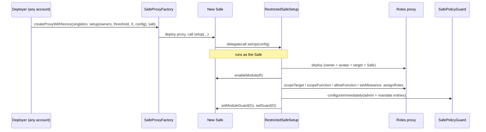

# Policy-restrained operator keys

Everything for this lives here or is linked from here:

| | |
|---|---|
| [examples/](examples/) | Complete config files to copy |
| [schema.json](schema.json) | JSON Schema of the config file |
| [src/factory/](../src/factory/) | `RestrictedSafeSetup`, the contract the new Safe delegatecalls |
| [script/factory/](../script/factory/) | The deploy script and its libraries, and the local end-to-end script |
| [test/factory/](../test/factory/) | Tests and the test fixture |

Write your own config anywhere in this folder (the script may read `safe-factory/` only).

Deploy a Safe with its owners, its operational keys (Zodiac Roles) and its Policy Engine floor from
**one config file, in one transaction**. No owner signs anything, and the Safe never exists without
its restrictions.

> **Funds migration.** This creates a new Safe; the keys and policies protect only what that Safe
> holds. If your funds are in a hot wallet, an EOA or an existing Safe today, move them to the new
> Safe after it is deployed and the script's check has passed, starting with a small test transfer.
> The operational keys must not keep funds of their own. (The address is known before deployment and
> only this exact config can be deployed there, so funds sent to it early are not at risk, but
> deploying and checking first is simpler to reason about.)

Run these from the repository root, after `pnpm install`:

```bash
# start from an example, then replace its 0x1111…-style placeholders
cp safe-factory/examples/payouts.json safe-factory/my-safe.json

# dry run: prints the Safe address and everything it is set up with; sends nothing
pnpm safe:deploy safe-factory/my-safe.json --rpc-url $RPC_URL

# deploy, from any funded account (it gets no rights over the Safe)
cast wallet import deployer --interactive   # once: store the deployer key in Foundry's keystore
pnpm safe:deploy safe-factory/my-safe.json --rpc-url $RPC_URL --broadcast --account deployer
```

It packages the architecture recommended in [OPERATOR_KEY_COMPARISON.md](../docs/OPERATOR_KEY_COMPARISON.md#8-recommendation):
Zodiac Roles v2.1.1 for the keys, and Safe Policy Engine as both transaction and module guard.

> Proof of concept, not audited. `RestrictedSafeSetup` and the policies in `src/sentinel/` are new code,
> and Safe Policy Engine is a safe-research project.

## How one transaction is enough

`Safe.setup(owners, threshold, to, data, ...)` delegatecalls `to` with `data` before the new Safe has any
state. Code running there runs **as the Safe**: every call it makes has `msg.sender == safe`, just like
an owner transaction, but with no signatures because there is nothing to sign against yet. If any step
fails, the whole creation reverts.

[`RestrictedSafeSetup`](../src/factory/RestrictedSafeSetup.sol) is that `to`. Called once per Safe, it:

1. deploys a Roles proxy whose owner, avatar and target are the Safe, and enables it as the Safe's module;
2. applies the role permissions and assigns the operational keys;
3. writes the Policy Engine entries with `configureImmediately` (allowed only while no guard is set);
4. installs the engine as module guard, then as transaction guard.



The Roles proxy has to be deployed from inside: its address depends on the Safe's address, and the
Safe's address depends on the setup data.

The Safe address is a hash of the config, so it is known before deployment. It is the same on every
chain where the canonical Safe contracts have the same addresses, and only that exact config can be
deployed there. A front-runner can only deploy the same Safe, and the script then finds it and
checks it.

## The config file

Two complete examples: [examples/payouts.json](examples/payouts.json) (USDC to two
payees, at most 1000 per transfer and 3000 a day) and
[examples/safenet-sentinel.json](examples/safenet-sentinel.json) (the
[SafeNet sentinel](../docs/SENTINEL.md)). They contain `0x1111…`-style placeholders, which the script refuses
to deploy. A JSON Schema for editors is in [schema.json](schema.json).

```json
{
  "name": "usdc-payouts",
  "safe": { "owners": ["0x…", "0x…", "0x…"], "threshold": 2, "saltNonce": 0 },
  "policyEngine": { "delay": 86400, "expiry": 604800, "ownerSwapMaxAbsent": 1 },
  "roles": [
    {
      "name": "PAYOUTS",
      "members": ["0x…"],
      "permissions": [
        { "kind": "transfer", "token": "0xA0b8…eB48", "recipients": ["0x…", "0x…"],
          "maxPerTx": "1000", "maxPerPeriod": "3000", "period": 86400 }
      ]
    }
  ],
  "ownerWithdrawals": [{ "token": "0xA0b8…eB48", "recipients": ["0x…"] }]
}
```

| Field | Meaning | Default |
|---|---|---|
| `name` | Label for the deployment record; not stored on chain | required |
| `safe.owners`, `safe.threshold` | The multisig | required |
| `safe.saltNonce` | Gives the same config a different address | `0` |
| `policyEngine.delay` | Seconds between requesting and applying any later engine change | `86400` |
| `policyEngine.expiry` | Seconds a requested change stays applicable | `604800` |
| `policyEngine.ownerSwapMaxAbsent` | `swapOwner` needs all owners but this many (and always more than the threshold) | `1` |
| `roles[].name` | 1 to 31 bytes. The role key is the name as `bytes32`, as in the Zodiac Roles app | required |
| `roles[].key` | Explicit role key instead (the sentinel example uses `keccak256("SENTINEL")`) | |
| `roles[].members` | The operational keys. Never a Safe owner | `[]` |
| `roles[].permissions` | See below | required |
| `ownerWithdrawals` | Tokens and recipients the owners may pay without an engine change | `[]` |
| `infrastructure` | Replace a canonical contract, e.g. a different Safe singleton | canonical |

Amounts are decimal strings in token units (`"800"`, `"0.4"`) and are converted with the token's
`decimals()`, read from the chain. Set `decimals` on the permission if the token is not deployed yet.

### Permission kinds

Each permission gives its role an exact Roles scope **and** adds the matching Policy Engine entry, so
the engine enforces the same mandate even if Roles is misconfigured or compromised.

| `kind` | Fields | Roles (per role) | Policy Engine (per Safe) |
|---|---|---|---|
| `call` | `target`, `functions` (signatures) | `allowFunction` for each function: any arguments, no ETH value | `AllowPolicy` |
| `transfer` | `token`, `recipients`, optional `maxPerTx`, `maxPerPeriod` + `period` | `transfer(to, amount)`: `to` ∈ recipients, `amount ≤ maxPerTx`, within a refilling allowance | `ERC20TransferPolicy`: recipients |
| `approve` | `token`, `spenders`, `maxAmount` | `approve(spender, amount)`: `spender` ∈ spenders, `amount ≤ maxAmount` | `ERC20ApproveCapPolicy`: spenders and cap |

`call` cannot grant `transfer`, `transferFrom`, `approve` or `increaseAllowance`; use the token kinds.
Within a role, one function on one target has one permission. The engine is keyed by `(target,
function)`, not by role, so its entry is the union over all roles: recipients and spenders are merged,
and an approve cap is the highest of any role. Each key is still held to its own role by Roles
(`test_roles_areIsolatedFromEachOther`).

## What the Safe looks like afterwards

| | |
|---|---|
| Owners | as configured |
| Modules | the Roles proxy, and nothing else |
| Transaction guard and module guard | `SafePolicyGuard(delay, expiry)`: default-deny for owners and modules alike |
| Roles | owned by the Safe; one role per config role; keys assigned |

Policy Engine entries:

| Entry | Policy | Why |
|---|---|---|
| Roles `assignRoles`, `scopeTarget`, `scopeFunction`, `allowFunction`, `revokeTarget`, `revokeFunction`, `setAllowance` | `OwnerOnlyPolicy` | Owners rotate keys and change mandates immediately; no module can |
| `Safe.disableModule` | `OwnerOnlyPolicy` | Kill switch: detach Roles in one owner transaction |
| `Safe.swapOwner` | `IncreasedThresholdPolicy` | Replacing an owner needs more signatures than the threshold |
| one per permission | see above | The mandate floor |
| one per `ownerWithdrawals` token | `ERC20TransferPolicy` | Owners can move funds out, to those recipients only |

Everything else is denied to everyone: other Safe admin functions, `Roles.allowTarget`, MultiSend,
delegatecall, ETH transfers, and every target not listed. The owners can still add an entry, after
the delay: `requestConfiguration(root)`, wait `delay`, then `applyConfiguration(entries)`
(`test_owners_otherChangesGoThroughTheEngineDelay`). The guard always lets owners make those two
calls, so they cannot lock themselves out.

## Operating it

A key acts with one ordinary transaction to the Roles module, with no bundler and no Safe signatures:

```text
roles.execTransactionWithRole(to, 0, data, 0 /* CALL */, roleKey, true)
```

| Task | How | Takes effect |
|---|---|---|
| Rotate or revoke a key | owner tx `roles.assignRoles(key, [role], [true/false])` | immediately |
| Change a role's limits or functions | owner txs on Roles (`scopeFunction`, `setAllowance`, `revokeFunction`, …) | immediately, within the engine floor |
| Widen the floor (new token, recipient, contract) | engine `requestConfiguration` → wait → `applyConfiguration`, then the Roles change | after `delay` |
| Stop all keys | owner tx `safe.disableModule(prev, roles)` | immediately |
| Withdraw | owner tx `token.transfer(recipient, amount)` to an `ownerWithdrawals` recipient | immediately |

## Shared contracts

The first deployment on a chain also deploys the shared contracts that are missing, which costs about
17M gas once. Each later Safe is a single transaction. For the test fixture (two roles, four mandate
entries) that is 1,868,189 gas with `createProxyWithNonce` (Ethereum mainnet) and 1,931,658 with
`createProxyWithNonceL2` (elsewhere; its event carries the full setup data).

**Canonical**, never deployed by the script. Overridable under `infrastructure`.

| Contract | Address |
|---|---|
| SafeL2 v1.5.0 (all chains except Ethereum mainnet, as Safe{Wallet} does) | `0xEdd160fEBBD92E350D4D398fb636302fccd67C7e` |
| Safe v1.5.0 (Ethereum mainnet) | `0xFf51A5898e281Db6DfC7855790607438dF2ca44b` |
| SafeProxyFactory v1.5.0 | `0x14F2982D601c9458F93bd70B218933A6f8165e7b` |
| CompatibilityFallbackHandler v1.5.0 | `0x3EfCBb83A4A7AfcB4F68D501E2c2203a38be77f4` |
| Zodiac ModuleProxyFactory | `0x000000000000aDdB49795b0f9bA5BC298cDda236` |
| EIP-2470 SingletonFactory (Roles stores its scopes through it) | `0xce0042B868300000d44A59004Da54A005ffdcf9f` |

Off mainnet the Safe is created with `createProxyWithNonceL2`, which gives the same address and emits
the event the Safe Transaction Service indexes.

**Deterministic**: deployed by whoever needs them first, through the CREATE2 deployer
`0x4e59b44847b379578588920cA78FbF26c0B4956C` with one fixed salt. The address follows from the
bytecode only, so it is the same on every chain and for every deployer
(`test_infra_addressesArePinned`).

| Contract | Source | Address |
|---|---|---|
| RestrictedSafeSetup | this repository | `0x31f444546E8A30261eb3Cb0dAe15805f38Bb911D` |
| SafePolicyGuard(1 day, 7 days) | safe-research/policy-engine | `0xA0bC7f48b28204987F8dCf3Bd4CFaB724812d71B` |
| AllowPolicy | safe-research/policy-engine | `0x9bB8973490cB62C98Cf5DE06252b82f3A0F6A1f0` |
| ERC20TransferPolicy | safe-research/policy-engine | `0xaB47a79ebE0D3cb60175A3a2e1c9AF983689a1E3` |
| IncreasedThresholdPolicy | safe-research/policy-engine | `0xF8Cf5706D7c24e8D7c0f64f5aE409e797BB3eD07` |
| ERC20ApproveCapPolicy | this repository | `0xa178267aC8D3FE564E2D238D075EE414344f1391` |
| OwnerOnlyPolicy | this repository | `0x46896Ba7558B78A272B1fFf7B01b314EE0893Ca1` |
| Zodiac Roles v2.1.1 mastercopy (+ Integrity, Packer) | gnosisguild, built here | `0x8b80f6Bb5922C4940FEa26fdcD1C73Bc39E9De83` |

A different `delay`/`expiry` gives a different guard address, deployed the same way. The bytecode
comes from this repository's build (`out/`), so the addresses depend on the compiler settings in
`foundry.toml`. The Roles mastercopy is this repository's build, which includes the Zodiac core patch
in `patches/`; it is not the Gnosis Guild deployment.

## What is enforced where

On chain, by `RestrictedSafeSetup`, whatever calldata it is given:

- It runs only as a delegatecall from a Safe that is still being set up (nonce 0, no module, no
  guard). It holds no state, so one deployment serves every Safe.
- Role permissions use only `scopeTarget`, `scopeFunction`, `allowFunction` and `setAllowance`. They
  allow no ETH value, no delegatecall and no whole-target grants, and never name the Safe, Roles or
  the guard.
- Mandate entries are CALL-only, always have a policy, and never target the Safe, Roles or the guard
  (`GuardTargetDenied` covers the guard too).
- The admin entries and both guards are always installed.

Off chain, by the script before it sends anything: config validation (duplicate owners, threshold,
an owner as an operational key, overlapping permissions, token movements through `call`, amounts,
placeholders). After deploying, it reads the Safe back and checks it
([RestrictedSafeCheck](../script/factory/RestrictedSafeCheck.sol)): owners, threshold, Roles as the
only module and owned by the Safe, both guards, the fallback handler, every entry, and no entry on
`addOwnerWithThreshold`, `removeOwner`, `changeThreshold`, `enableModule`, `setGuard`,
`setModuleGuard`, `setFallbackHandler` or the fallback selector. Running the script again on a
deployed Safe repeats that check.

## Limits and open questions

- **New Safes only, so funds must be migrated.** Whatever holds the funds today (a hot wallet, an EOA,
  an existing Safe) keeps its current risk until the funds are moved to the new Safe. Converting an
  existing Safe in place needs its owners to sign the same calls, as
  [SentinelSetup](../script/sentinel/SentinelSetup.sol) does. That is not automated here.
- **The mandate vocabulary is small:** contract calls with any arguments, plus ERC-20 transfer and
  approve with bounds. There are no ETH transfers, no argument conditions on `call`, no batches and no
  key expiry (Roles v2.1.1 has none).
- **`call` entries use `AllowPolicy` in the engine,** which checks neither arguments nor value. Roles
  still blocks value. For those functions the floor protects only which target and function are
  called.
- **`ownerWithdrawals` recipients are reachable by a compromised Roles module.** Upstream
  `ERC20TransferPolicy` does not distinguish owner and module transactions. The engine still limits
  such a payment to those recipients.
- **`swapOwner` needs signatures beyond the threshold,** passed to `IncreasedThresholdPolicy` in the
  Policy Engine signature context. Every other owner change goes through the engine delay.
- **Safe{Wallet}:** the Safe shows up as a normal v1.5.0 Safe with an unknown guard. Owner transactions
  must use `safeTxGas = 0` and `gasPrice = 0` (the engine rejects others), and anything without an
  entry is denied. Whether the Zodiac Roles app recognises a mastercopy built here, rather than the
  Gnosis Guild deployment, has not been checked.
- **Local chains:** anvil has no EIP-2470 factory. On a fresh node the first run installs it and
  asks to be run again, because forge re-simulates on a fork taken before the install.

## Tests

| Command | What |
|---|---|
| `forge test --mc RestrictedSafe` | 31 tests. The Safe matches its config; JSON and Solidity configs give the same Safe; keys stay within their mandate; a compromised module is bounded by the engine; owners rotate keys, use the kill switch, withdraw and change the engine after the delay; the setup contract's invariants; front-running; config validation; pinned addresses; the shipped examples |
| `pnpm safe:e2e` | Anvil end to end: dry run, broadcast from a non-owner, the key's allowed and refused transfers via `cast`, and an idempotent re-run |

The sentinel example also simulates cleanly against Gnosis Chain mainnet (production Safe contracts,
USDC.e and SentinelOracle) once its placeholders are replaced:
`pnpm safe:deploy <filled-in config> --rpc-url https://rpc.gnosischain.com`.

## Code

| Path | What |
|---|---|
| [src/factory/RestrictedSafeSetup.sol](../src/factory/RestrictedSafeSetup.sol) | The setup contract the new Safe delegatecalls (MIT, imports nothing) |
| [script/factory/DeployRestrictedSafe.s.sol](../script/factory/DeployRestrictedSafe.s.sol) | The script: read, deploy what is missing, create, check, report |
| [script/factory/RestrictedSafePlan.sol](../script/factory/RestrictedSafePlan.sol) | Config to Roles calls, engine entries and `Safe.setup` calldata (pure) |
| [script/factory/RestrictedSafeJson.sol](../script/factory/RestrictedSafeJson.sol) | The config file reader |
| [script/factory/RestrictedSafeInfra.sol](../script/factory/RestrictedSafeInfra.sol) | Canonical and deterministic addresses, and their deployment |
| [script/factory/RestrictedSafeCheck.sol](../script/factory/RestrictedSafeCheck.sol) | Reads a deployed Safe back and checks it against the plan |
| [test/factory/](../test/factory/) | Tests and the fixture config |
